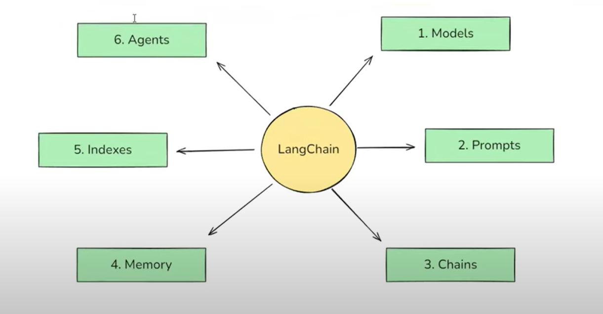

# LangChain Notes

## 1. What Is LangChain?

LangChain is an open-source framework for building applications powered by large language models (LLMs).

An LLM can generate text, answer questions, summarize documents, and reason about instructions. However, a useful application usually needs more than a single model call. It may need prompts, external data, tools, structured results, memory, retrieval, and multiple processing steps.

LangChain provides reusable abstractions and integrations for connecting these parts into an application.

### Simple Definition

> LangChain is a framework that helps developers connect language models with prompts, data, tools, workflows, and application logic.

### What Can Be Built with LangChain?

- Chatbots and conversational assistants
- Retrieval-Augmented Generation (RAG) applications
- Document question-answering systems
- Research assistants
- Summarization and classification pipelines
- Agents that use tools and APIs
- Structured data extraction systems
- Multi-step LLM workflows

### Basic LangChain Application

```text
User Input
    ↓
Prompt Template
    ↓
Language Model
    ↓
Output Parser
    ↓
Application Response
```

LangChain does not replace the language model. It provides the application layer around the model.

---

## 2. Problems Before LangChain

Before using a framework, developers could call an LLM directly through a provider's SDK. That is sufficient for a small experiment:

```python
response = client.chat.completions.create(
    model="some-model",
    messages=[{"role": "user", "content": "Explain RAG"}],
)
```

The difficulty starts when the application grows.

### 2.1 Repetitive Provider-Specific Code

Different providers may have different SDKs, authentication methods, request formats, message formats, and response objects. Changing from OpenAI to Gemini, Groq, or Ollama can require changes throughout the codebase.

### 2.2 Difficult Prompt Management

Without reusable templates, prompts are often written as long strings inside application code. This makes reuse, testing, versioning, and system/user message management difficult.

### 2.3 Manual Multi-Step Workflows

If an application needed multiple model calls, we had to manually pass the output of one step into the next step. This created complicated and difficult-to-maintain code.

### 2.4 Difficult Structured Output Handling

An LLM naturally returns text, while software often needs predictable data:

```json
{
  "sentiment": "positive",
  "score": 0.92,
  "reason": "The customer praised the product."
}
```

Without parsing and validation, developers must write their own JSON conversion, schema checking, retries, and error handling.

### 2.5 No Direct Access to Private or Current Information

The model may not know internal documents, today's product information, recently updated policies, or data in our database. A separate pipeline is required to load, split, embed, store, retrieve, and pass relevant context to the model.

### 2.6 Tool Integration Was Manual

Connecting an LLM to search, databases, APIs, calculators, or application functions required custom schemas, tool-selection logic, execution code, and result handling.

### 2.7 Limited Observability

It was difficult to inspect a complete LLM workflow, including the prompt sent to the model, intermediate results, latency, token usage, and errors.

### Before LangChain

```text
Application Code
    ├── Provider-specific model SDK
    ├── Manually formatted prompts
    ├── Custom output parsing
    ├── Custom document ingestion
    ├── Custom vector search
    ├── Custom tool execution
    └── Custom logging and tracing
```

> A direct SDK is not wrong. It is often enough for one simple model call. The problems appear when the application becomes multi-step, data-aware, or tool-using.

---

## 3. What Does LangChain Solve?

LangChain solves the integration and orchestration problems involved in building LLM applications.

### 3.1 Common Interfaces for Models

LangChain provides common interfaces for chat models, embeddings, retrievers, tools, and other components. This makes application code more consistent and makes it easier to change providers.

For example, the same general pattern can be used with different chat-model integrations:

```python
response = model.invoke("What is generative AI?")
```

The provider-specific implementation remains inside the integration package.

### 3.2 Reusable Prompt Templates

Prompt templates separate instructions from changing input values.

```python
from langchain_core.prompts import PromptTemplate

prompt = PromptTemplate(
    template="Explain {topic} in simple language.",
    input_variables=["topic"],
)
```

### 3.3 Composable Workflows

LangChain components can be connected using LCEL's pipe operator:

```python
chain = prompt | model | parser
```

The output of one component becomes the input of the next component.

### 3.4 Output Parsing and Validation

LangChain provides parsers for strings, JSON, structured schemas, and Pydantic models. This helps convert model output into a format that application code can use.

### 3.5 Data Ingestion and Retrieval

LangChain provides integrations and abstractions for the RAG pipeline:

```text
Documents → Document Loader → Text Splitter → Embeddings → Vector Store → Retriever → Relevant Context + User Question → Language Model → Answer
```

### 3.6 Tools and Tool Calling

A Python function can be exposed as a tool with a name, description, and input schema:

```python
from langchain_core.tools import tool

@tool
def multiply(a: int, b: int) -> int:
    """Multiply two numbers."""
    return a * b
```

The model suggests a tool call. The application or agent executes the tool and sends the result back to the model.

### 3.7 Observability and Deployment Integrations

LangChain applications can be connected to LangSmith for tracing and evaluation, and LangServe can expose chains through APIs.

### Overall Problem-to-Solution Mapping

| Problem                        | LangChain capability                       |
| ------------------------------ | ------------------------------------------ |
| Provider-specific model code   | Standard model interfaces and integrations |
| Repeated prompt strings        | Prompt templates                           |
| Complex multi-step logic       | Chains, runnables, and LCEL                |
| Unreliable text output         | Output parsers and structured output       |
| Private or current information | Document loaders and retrievers            |
| Semantic search                | Embeddings and vector stores               |
| External actions               | Tools and tool calling                     |
| Difficult debugging            | LangSmith tracing and observability        |
| Exposing workflows as APIs     | LangServe and web frameworks               |

---

## 4. Why Do We Need LangChain?

We need LangChain when an application must do more than send one prompt to one model. The more an application needs data, tools, validation, memory, multiple steps, and monitoring, the more valuable an orchestration framework becomes.

### Use LangChain When You Need To:

- Build a reusable LLM application instead of a one-off experiment
- Connect an LLM to private documents or live data
- Use multiple model calls in a workflow
- Enforce a predictable output format
- Give a model access to tools or APIs
- Switch between model providers more easily
- Add retrieval, memory, or conversation history
- Trace, test, and debug LLM behavior
- Create a complete RAG or agent system

### When LangChain May Not Be Necessary

For a very small application that only makes one simple model call, the provider's SDK may be enough. LangChain becomes more valuable as the application's workflow, integrations, and reliability requirements grow.

### Key Idea

> LangChain is an orchestration layer between the application and the language model.

It helps organize the complete workflow:

```text
Application
    ↓
LangChain Components
    ├── Models
    ├── Prompts
    ├── Parsers
    ├── Runnables and Chains
    ├── Loaders and Splitters
    ├── Embeddings and Vector Stores
    ├── Retrievers
    ├── Tools
    └── Agents
    ↓
Language Models + External Data + External Actions
```

---

---

## 5. LangChain v1 Overview

LangChain v1 is the modern LangChain release focused on building dependable LLM applications and agents with clear, composable building blocks.

### What Changed in the v1 Way of Thinking?

Older LangChain examples often focused on class-based chains such as `LLMChain` and large framework abstractions. In the v1 style, we generally build workflows from smaller components:

```text
Prompt + Model + Parser + Runnable Logic
```

The pipe operator makes the data flow explicit:

```python
chain = prompt | model | parser
```

### Important v1 Ideas

- Use modern model integrations such as `ChatOpenAI`, `ChatGoogleGenerativeAI`, and `ChatGroq` from their provider packages.
- Use `langchain_core` for prompts, messages, runnables, tools, and parsers.
- Use `invoke()` for one input, `batch()` for multiple inputs, and `stream()` when partial output is useful.
- Prefer `with_structured_output()` when the selected model supports it and the application needs structured data.
- Use LangChain agents for straightforward tool-using agent applications.
- Use LangGraph when the workflow needs deeper state management, durable execution, human approval, or custom graph control.

### A Modern v1 Application Flow

```text
User Input
    ↓
Prompt / Messages
    ↓
Chat Model
    ├── Direct Answer
    ├── Structured Output
    └── Tool Call → Tool Result → Model
    ↓
Final Application Result
```

---

---

## 6. LangChain Components



> Note: These are learning categories, not seven completely separate packages. Some capabilities overlap. For example, embeddings, vector stores, document loaders, and retrievers together form the RAG stack, while callbacks and observability support every other component.

---

---

## 7. Models

### What Is a Model in LangChain?

A model is the component that interacts with an AI model provider. In LangChain, model objects expose common methods and can be composed with prompts, parsers, retrievers, and tools.

1. Language Models: LLMs and Chat Models
2. Embedding Models

### 7.1 Language Models: LLMs and Chat Models

#### LLMs

Traditional LLMs take a raw string prompt and return a raw string response. They are designed primarily for text completion.

```python
from langchain_openai import OpenAI

llm = OpenAI(model="gpt-3.5-turbo-instruct")
response = llm.invoke("Explain embeddings in one paragraph.")
```

#### Chat Models

Chat models take a sequence of messages rather than only a raw string. Each message has a role, such as `system`, `human`, `assistant`, or `tool`.

They are designed for conversational interactions and can support additional capabilities such as tool calling, streaming, multimodal input, and structured output, depending on the provider and model.

```python
from langchain_groq import ChatGroq

model = ChatGroq(model="openai/gpt-oss-20b")
response = model.invoke("Explain embeddings in one paragraph.")
print(response.content)
```

The response is usually an `AIMessage`, not just a plain string. It may contain content, metadata, token usage, and tool calls.

#### LLMs Versus Chat Models

| Feature      | LLM                                    | Chat Model                             |
| ------------ | -------------------------------------- | -------------------------------------- |
| Input        | Raw string                             | Sequence of messages                   |
| Output       | Usually raw string                     | Usually an `AIMessage`                 |
| Main use     | Text completion                        | Conversation and instruction following |
| Roles        | Not central                            | System, human, AI, and tool roles      |
| Modern usage | Useful for legacy or completion models | Common choice for current applications |

### 7.2 Embedding Models

Embedding models do not generate conversational answers. They convert text into numerical vectors that capture semantic meaning.

These vectors allow applications to compare text by meaning rather than only by exact words. Texts with similar meanings are represented by vectors that are close together in vector space.

```text
Text → Embedding Model → Numerical Vector
```

Embedding models are mainly used for:

- Semantic search
- RAG applications
- Similarity comparison

```python
from langchain_openai import OpenAIEmbeddings

embeddings = OpenAIEmbeddings(model="text-embedding-3-large")

query_vector = embeddings.embed_query(
    "How can I reset my password?"
)

document_vectors = embeddings.embed_documents([
    "Password reset instructions",
    "Company holiday policy",
])
```

Embedding models are used during two stages of a RAG workflow:

```text
Indexing time:
Documents → Embeddings → Vector Store

Query time:
User Question → Query Embedding → Similarity Search
```

### Common Model Methods

| Method                           | Use                               |
| -------------------------------- | --------------------------------- |
| `invoke(input)`                  | Run the model once                |
| `ainvoke(input)`                 | Run asynchronously                |
| `batch(inputs)`                  | Process multiple inputs           |
| `stream(input)`                  | Receive output progressively      |
| `bind_tools(tools)`              | Make tools available to the model |
| `with_structured_output(schema)` | Request a structured result       |
| `with_retry(...)`                | Retry failed calls                |

### Model Configuration

Common configuration options include:

- Model name
- API key or provider credentials
- Temperature
- Maximum output tokens
- Request timeout
- Retry count
- Streaming

The exact options depend on the provider and model.

### Model Selection Is a Trade-Off

There is no universally best model. Choose based on:

- Quality and reasoning capability
- Speed and latency
- Cost
- Context-window size
- Tool-calling support
- Structured-output support
- Privacy and deployment requirements
- Availability of streaming and asynchronous calls

---

---

## 8. Prompts and Messages

### What Is a Prompt?

A prompt is the instruction and context given to a model. A good prompt explains the task, supplies required information, and defines the desired response.

### Static Prompt

```python
response = model.invoke("Explain retrieval in simple language.")
```

This is useful for a one-off request, but it is not reusable.

### Prompt Template

A prompt template contains fixed instructions and placeholders for changing values:

```python
from langchain_core.prompts import PromptTemplate

prompt = PromptTemplate.from_template(
    "Explain {topic} for a beginner using one example."
)

formatted_prompt = prompt.invoke({"topic": "vector stores"})
```

### Chat Prompt Template

Chat prompts represent a conversation using message roles:

```python
from langchain_core.prompts import ChatPromptTemplate

prompt = ChatPromptTemplate.from_messages([
    ("system", "You are a clear and patient teacher."),
    ("human", "Explain {topic} with a practical example."),
])

chain = prompt | model
response = chain.invoke({"topic": "retrievers"})
```

### Message Roles

| Role               | Responsibility                                       |
| ------------------ | ---------------------------------------------------- |
| `system`           | Defines behavior, rules, and high-level instructions |
| `human` / `user`   | Contains the user's request or input                 |
| `assistant` / `ai` | Represents an earlier model response                 |
| `tool`             | Contains the result returned by a tool               |

### Message History

Conversation history is a list of messages. Passing previous messages gives the model context about earlier turns.

```python
messages = [
    ("system", "You are a helpful assistant."),
    ("human", "What is RAG?"),
    ("ai", "RAG means Retrieval-Augmented Generation."),
    ("human", "Why is it useful?"),
]

response = model.invoke(messages)
```

### Message Placeholder

When the history is dynamic, use a placeholder:

```python
from langchain_core.prompts import ChatPromptTemplate, MessagesPlaceholder

prompt = ChatPromptTemplate.from_messages([
    ("system", "You are a helpful assistant."),
    MessagesPlaceholder("history"),
    ("human", "{question}"),
])
```

### Prompt Design Checklist

Before sending a prompt, clarify:

1. What role should the model play?
2. What task should it perform?
3. What context is trustworthy?
4. What format should it return?
5. What should it do when information is missing?
6. Which input values are dynamic?

### Prompt and Model Composition

```text
Template Input
     ↓
Formatted Messages
     ↓
Chat Model
     ↓
AIMessage
```

Use a parser after the model when the application needs a specific output type.

---

## 9. Output Parsers and Structured Output

### Why Do We Need Output Parsing?

Models generate responses probabilistically. A human can understand a natural-language answer, but software needs predictable data.

For example, an application may need:

```python
{
    "name": "Alice",
    "age": 30,
    "city": "Delhi",
}
```

Output parsers convert model responses into a format the application can use.

### 9.1 String Output Parser

`StrOutputParser` extracts a string from the model response.

```python
from langchain_core.output_parsers import StrOutputParser

chain = prompt | model | StrOutputParser()
answer = chain.invoke({"topic": "RAG"})
```

### 9.2 JSON Output Parser

`JsonOutputParser` converts a JSON response into a Python dictionary. It can also provide format instructions for the prompt.

```python
from langchain_core.output_parsers import JsonOutputParser

parser = JsonOutputParser()

prompt = PromptTemplate(
    template="Return the name and age.\n{format_instructions}",
    input_variables=[],
    partial_variables={
        "format_instructions": parser.get_format_instructions()
    },
)

chain = prompt | model | parser
result = chain.invoke({})
```

JSON parsing checks whether the response is valid JSON, but a basic JSON parser does not necessarily guarantee that every required field has the correct type or value.

### 9.3 Structured Output Parser

`StructuredOutputParser` lets us describe expected fields with `ResponseSchema` objects and generate format instructions.

It is useful when we need a predefined set of fields, but it does not provide the same level of Python-side validation as a Pydantic model.

### 9.4 Pydantic Output Parser

A Pydantic model defines the expected fields and validates the result:

```python
from pydantic import BaseModel, Field
from langchain_core.output_parsers import PydanticOutputParser

class Person(BaseModel):
    name: str
    age: int = Field(gt=0)
    city: str

parser = PydanticOutputParser(pydantic_object=Person)
chain = prompt | model | parser
person = chain.invoke({})
```

The result is a validated `Person` object rather than an unverified string.

### 9.5 Modern Structured Output

When the model integration supports it, the modern approach is often:

```python
structured_model = model.with_structured_output(Person)
result = structured_model.invoke("Alice is 30 and lives in Delhi.")
```

This is different from manually asking the model to print JSON and then parsing text. The provider integration may use native structured output or tool-calling capabilities behind the scenes.

### Parser Comparison

| Parser or method           | Result                       | Validation level                                                    |
| -------------------------- | ---------------------------- | ------------------------------------------------------------------- |
| `StrOutputParser`          | String                       | No schema validation                                                |
| `JsonOutputParser`         | Python dictionary            | JSON syntax validation                                              |
| `StructuredOutputParser`   | Dictionary with named fields | Field instructions, limited validation                              |
| `PydanticOutputParser`     | Pydantic object              | Python type and constraint validation                               |
| `with_structured_output()` | Schema-defined result        | Depends on model/provider support; usually preferred when available |

### Structured Output Best Practices

- Define clear field names and descriptions.
- Use enums or `Literal` for limited choices.
- Add Pydantic constraints where possible.
- Handle parsing failures and model refusals.
- Do not assume a schema makes the model's answer factually correct.
- Validate business rules after parsing.
- Prefer native structured output when supported by the selected model.

---

---

## 10. Chains and LCEL

### What Is a Chain?

A chain is a sequence of LangChain components connected to complete a task. The output of one component becomes the input of the next component.

```text
Input → Prompt → Model → Parser → Output
```

For example, a simple question-answering chain may contain a prompt template, a chat model, and a string output parser.

```python
from langchain_core.output_parsers import StrOutputParser

chain = prompt | model | StrOutputParser()
result = chain.invoke({"topic": "RAG"})
```

### What Is LCEL?

LCEL means LangChain Expression Language. It provides a declarative way to compose LangChain components using the pipe operator (`|`).

```python
chain = prompt | model | parser
```

This is similar to a Unix pipeline: one step passes its output to the next step.

### Why Use LCEL?

LCEL makes workflows:

- Easier to read
- Easier to compose
- Reusable
- Streamable
- Batchable
- Compatible with synchronous and asynchronous execution
- Easier to trace and inspect

### Common Chain Patterns

### 1. Simple Chain

A simple chain connects components in a straight line. Use it when one model call is enough.

```py
model = ChatGroq(model="llama-3.1-8b-instant")

prompt = PromptTemplate(
    template="Generate 5 interesting facts about {topic}.",
    input_variables=["topic"]
)

parser = StrOutputParser()

# Simple Chain
chain = prompt | model | parser

# Invoke chain
response = chain.invoke({"topic": "space exploration"})

print(response)
```

**Graph of the chain in ASCII format**

```py
chain.get_graph().print_ascii()
```

```
     +-------------+
     | PromptInput |
     +-------------+
            *
            *
    +----------------+
    | PromptTemplate |
    +----------------+
            *
            *
      +----------+
      | ChatGroq |
      +----------+
            *
            *
   +-----------------+
   | StrOutputParser |
   +-----------------+
            *
            *
+-----------------------+
| StrOutputParserOutput |
+-----------------------+
```

### 2. Sequential Chain

A sequential chain runs multiple steps one after another. The output of one step becomes the input of the next step.

One step runs after another:

```text
Input → Chain 1 → Chain 2 → Chain 3 → Output
```

Example:

```py
model = ChatGroq(model="llama-3.1-8b-instant")

prompt1 = PromptTemplate(
    template="Generate a report on {topic}.",
    input_variables=["topic"]
)

prompt2 = PromptTemplate(
    template="Generate a 5 short summary of the following text: {text}.",
    input_variables=["text"]
)

parser = StrOutputParser()

# Create Sequential chain
chain = prompt1 | model | parser | prompt2 | model | parser

# invoke it
response = chain.invoke({"topic": "Unemployment in India"})

print(response)

# graph in ASSIC
chain.get_graph().print_ascii()
```

```
     +-------------+
     | PromptInput |
     +-------------+
            *
            *
    +----------------+
    | PromptTemplate |
    +----------------+
            *
            *
      +----------+
      | ChatGroq |
      +----------+
            *
            *
   +-----------------+
   | StrOutputParser |
   +-----------------+
            *
            *
+-----------------------+
| StrOutputParserOutput |
+-----------------------+
            *
            *
    +----------------+
    | PromptTemplate |
    +----------------+
            *
            *
      +----------+
      | ChatGroq |
      +----------+
            *
            *
   +-----------------+
   | StrOutputParser |
   +-----------------+
            *
            *
+-----------------------+
| StrOutputParserOutput |
+-----------------------+
```

### 3. Parallel Chain

A parallel chain runs independent tasks at the same time and returns their results together. Use it when the tasks do not depend on one another.

Independent tasks run from the same input:

```text
             ┌─→ Notes ─┐
Input ───────┤          ├→ Combined Result
             └─→ Quiz ──┘
```

Example:

```py
model1 = ChatGroq(model="llama-3.1-8b-instant")

model2 = ChatGroq(model="openai/gpt-oss-20b")

prompt1 = PromptTemplate(
    template="Generate short and simple notes from following text: {text}.",
    input_variables=["text"]
)

prompt2 = PromptTemplate(
    template="Generate 5 short questions and answers from the following text: {text}.",
    input_variables=["text"]
)

prompt3 = PromptTemplate(
    template="Merge the provided notes and quize into a single document \n Notes: {notes} \n Quiz: {quiz}",
    input_variables=["notes", "quiz"]
)

parser = StrOutputParser()

# Create a parallel chain to run multiple chains concurrently
Parallel_chain = RunnableParallel({
    'notes': prompt1 | model1 | parser,
    'quiz': prompt2 | model2 | parser
})

marge_chain = prompt3 | model1 | parser

chain = Parallel_chain | marge_chain

# invoke it
response = chain.invoke({"text": text})

print(response)

chain.get_graph().print_ascii()
```

```
          +---------------------------+
          | Parallel<notes,quiz>Input |
          +---------------------------+
                **               **
              **                   **
            **                       **
+----------------+              +----------------+
| PromptTemplate |              | PromptTemplate |
+----------------+              +----------------+
          *                             *
          *                             *
    +----------+                  +----------+
    | ChatGroq |                  | ChatGroq |
    +----------+                  +----------+
          *                             *
          *                             *
+-----------------+            +-----------------+
| StrOutputParser |            | StrOutputParser |
+-----------------+            +-----------------+
                 **             **
                   **         **
                     **     **
          +----------------------------+
          | Parallel<notes,quiz>Output |
          +----------------------------+
                         *
                         *
                +----------------+
                | PromptTemplate |
                +----------------+
                         *
                         *
                   +----------+
                   | ChatGroq |
                   +----------+
                         *
                         *
                +-----------------+
                | StrOutputParser |
                +-----------------+
                         *
                         *
            +-----------------------+
            | StrOutputParserOutput |
            +-----------------------+
```

### 4. Conditional Chain

A conditional chain chooses one branch based on a condition or a previous result. Use it when different inputs need different workflows.

A branch is selected based on the input or a previous result:

```text
Input → Classifier → Positive Branch
                 └→ Negative Branch
```

In Conditional Chain, we can run different chains based on the output of a previous chain.

### Conditional Chain: Short Example

```python
from langchain_core.runnables import RunnableBranch

positive = PromptTemplate.from_template("Thank the customer: {feedback}") | model | parser
negative = PromptTemplate.from_template("Apologize to the customer: {feedback}") | model | parser

chain = RunnableBranch(
    (lambda x: x["sentiment"] == "positive", positive),
    negative,  # default branch
)

result = chain.invoke({
    "sentiment": "positive",
    "feedback": "I loved the product!",
})
```

The complete sentiment-classification example is available in `E_langchain_chains/4_conditional_chain.py`.

### Chain Patterns: Quick Revision

| Pattern     | Simple meaning                 | Typical use                       |
| ----------- | ------------------------------ | --------------------------------- |
| Simple      | One straight workflow          | Prompt → Model → Parser           |
| Sequential  | Steps run one after another    | Report → Summary                  |
| Parallel    | Independent steps run together | Notes and quiz from the same text |
| Conditional | Select one branch              | Positive versus negative feedback |

```text
Simple:      Input → A → B → Output
Sequential:  Input → A → B → C → Output
Parallel:    Input → A ─┐
                     B ─┴→ Output
Conditional: Input → Condition → Branch A or Branch B
```

### Chain Execution Methods

```python
chain.invoke(input)       # One input
chain.batch([input1, input2])  # Multiple inputs
chain.stream(input)       # Stream output
await chain.ainvoke(input)     # Asynchronous execution
```

---

---

## 11. Runnables

### What Is a Runnable?

A Runnable is a component that follows a common execution interface. Prompts, models, parsers, retrievers, functions, and many other LangChain objects can be used as runnables.

The common interface allows different components to be composed consistently.

```text
Runnable Input → Runnable Processing → Runnable Output
```

### Runnable Categories

#### 1. Task-Specific Runnables

These are LangChain components that perform a particular task and can participate in a pipeline.

Examples:

- Chat model: runs an LLM call
- Prompt template: formats dynamic input
- Output parser: converts model output
- Retriever: fetches relevant documents
- Tool: performs an external action

#### 2. Runnable Primitives

These are building blocks for controlling how components interact. They define whether steps run sequentially, in parallel, conditionally, or through a custom Python function.

The main primitives studied in this workspace are:

1. `RunnableSequence` — runs steps in order.
2. `RunnableParallel` — runs independent steps at the same time.
3. `RunnablePassthrough` — forwards the input unchanged.
4. `RunnableLambda` — wraps a Python function as a runnable.
5. `RunnableBranch` — implements conditional `if/else` execution.

`RunnableMap` is commonly used as another name or pattern for mapping one input into multiple runnable outputs. In modern LCEL code, this behavior is commonly expressed with `RunnableParallel`.

### Common Runnable Types

| Runnable              | Purpose                                    |
| --------------------- | ------------------------------------------ |
| `RunnableSequence`    | Execute components one after another       |
| `RunnableParallel`    | Execute independent components in parallel |
| `RunnablePassthrough` | Pass the input forward unchanged           |
| `RunnableLambda`      | Convert a Python function into a runnable  |
| `RunnableBranch`      | Select a runnable based on a condition     |

### 1. Runnable Sequence

Runs each component in order. The output of one step becomes the input of the next step.

```python
from langchain_core.runnables import RunnableSequence

chain = RunnableSequence(prompt, model, parser)
print(chain.invoke({"topic": "embeddings"}))
```

The pipe operator is commonly used as a shorter LCEL representation of a sequence.

```python
chain = prompt | model | parser
```

### 2. Runnable Parallel

Runs independent runnables together and returns their results in a dictionary.

```python
from langchain_core.runnables import RunnableParallel

parallel = RunnableParallel(
    summary=summary_chain,
    questions=question_chain,
)

result = parallel.invoke({"text": document_text})
```

The result is a dictionary containing the output of each branch.

### 3. Runnable Passthrough

`RunnablePassthrough` forwards the original input without changing it. It is useful when one input must be sent to multiple parts of a workflow.

```text
Original Input → Retriever
               └→ Prompt Input
```

```python
from langchain_core.runnables import RunnablePassthrough

chain = RunnablePassthrough()
print(chain.invoke("same input"))
```

### 4. Runnable Lambda

`RunnableLambda` wraps a normal Python function so it can participate in a chain.

```python
from langchain_core.runnables import RunnableLambda

uppercase = RunnableLambda(lambda text: text.upper())
result = uppercase.invoke("langchain")
```

It is useful for preprocessing, word counting, filtering, formatting, and post-processing.

### 5. Runnable Branch

`RunnableBranch` selects one runnable when a condition is true and another runnable otherwise.

```text
Input → Condition
          ├── True  → Runnable A
          └── False → Runnable B
```

```python
from langchain_core.runnables import RunnableBranch

branch = RunnableBranch(
    (lambda x: x > 10, RunnableLambda(lambda x: "large")),
    RunnableLambda(lambda x: "small"),  # default branch
)

print(branch.invoke(5))   # small
print(branch.invoke(20))  # large
```

### LCEL: The Shorter Runnable Syntax

`RunnableSequence` can become lengthy when many components are connected. LCEL provides the shorter pipe syntax:

```python
chain = prompt | model | parser
```

This is the most common way to create a sequential runnable workflow.

### Why Runnables Matter

Runnables create a common language for composing LangChain applications. Instead of writing custom orchestration code for every component, we connect components with a shared interface.

---

---

## 12. Document Loaders

### What Is a Document Loader?

A document loader reads data from a source and converts it into LangChain `Document` objects.

A `Document` generally contains:

```python
Document(
    page_content="The actual text",
    metadata={"source": "sample.txt"},
)
```

The `page_content` contains the text. The `metadata` contains useful information such as the source, page number, title, or URL.

### Why Do We Need Document Loaders?

Different data sources have different formats. A PDF is not read in the same way as a web page or a directory of text files.

Document loaders provide a consistent output format so that the rest of the RAG pipeline can work with the data in the same way.

```text
PDF / Text / Website / ArXiv / Wikipedia
                    ↓
             Document Loader
                    ↓
          List[Document]
```

### Common Loaders in This Workspace

| Loader            | Source                        |
| ----------------- | ----------------------------- |
| `TextLoader`      | Text files                    |
| `PyPDFLoader`     | PDF files and pages           |
| `DirectoryLoader` | Multiple files in a directory |
| `WebBaseLoader`   | Web pages                     |
| `ArxivLoader`     | ArXiv papers                  |
| `WikipediaLoader` | Wikipedia content             |

### Text Loader

```python
from langchain_community.document_loaders import TextLoader

loader = TextLoader("sample.txt", encoding="utf-8")
documents = loader.load()
```

### PDF Loader

```python
from langchain_community.document_loaders import PyPDFLoader

loader = PyPDFLoader("attention.pdf")
documents = loader.load()
```

`PyPDFLoader` is designed mainly for text-based PDFs. It extracts text and returns a list of LangChain `Document` objects. In the common page mode, each page may become a separate `Document` with page-related metadata.

> Important: `PyPDFLoader` is not an OCR solution. It may extract little or no useful text from scanned PDFs or pages where the content is stored as images.

#### Choosing a PDF Loader

| PDF type or requirement            | Recommended loader                                   |
| ---------------------------------- | ---------------------------------------------------- |
| Simple, clean, text-based PDF      | `PyPDFLoader`                                        |
| PDF with tables or columns         | `PDFPlumberLoader`                                   |
| Scanned or image-based PDF         | `UnstructuredPDFLoader` or `AmazonTextractPDFLoader` |
| Need layout and image-related data | `PyMuPDFLoader`                                      |
| Need richer structure extraction   | `UnstructuredPDFLoader`                              |

The correct choice depends on the document layout, OCR needs, table quality, metadata requirements, and deployment environment. Always inspect the extracted text before sending it to a splitter or embedding model.

#### PyPDFLoader Example

```python
from langchain_community.document_loaders import PyPDFLoader

loader = PyPDFLoader("attention.pdf")
documents = loader.load()

print(f"Pages loaded: {len(documents)}")
print(documents[0].page_content[:500])
print(documents[0].metadata)
```

#### PDF Ingestion Checklist

1. Identify whether the PDF contains real text or scanned images.
2. Select a loader that matches the layout and extraction requirement.
3. Inspect a few pages and their metadata.
4. Check tables, columns, headers, footers, and page numbers.
5. Use OCR when the PDF contains images of text.
6. Split the extracted documents only after verifying the content.

### Web Loader

```python
from langchain_community.document_loaders import WebBaseLoader

loader = WebBaseLoader("https://example.com/article")
documents = loader.load()
```

Web loaders may require HTML parsing and filtering so that navigation menus and unrelated page content are not included.

#### Filtered WebBaseLoader Example

```python
from langchain_community.document_loaders import WebBaseLoader
import bs4

loader = WebBaseLoader(
    web_paths=("https://lilianweng.github.io/posts/2023-06-23-agent",),
    bs_kwargs={
        "parse_only": bs4.SoupStrainer(
            class_=("post-title", "post-content", "post-header")
        )
    },
)

documents = loader.load()
print(documents[0].page_content[:500])
```

`SoupStrainer` limits extraction to the important article sections. This can reduce navigation text, advertisements, and unrelated HTML from entering the RAG pipeline.

### ArXiv Loader

`ArxivLoader` loads research papers from ArXiv using a paper identifier or search query.

```python
from langchain_community.document_loaders import ArxivLoader

documents = ArxivLoader(
    query="1706.03762",  # Attention Is All You Need
    load_max_docs=1,
).load()

print(documents[0].page_content[:500])
print(documents[0].metadata)
```

Use the paper identifier when you need a specific paper. For larger ingestion jobs, handle rate limits, retries, duplicate papers, and metadata carefully.

### Wikipedia Loader

`WikipediaLoader` retrieves Wikipedia pages for a search query.

```python
from langchain_community.document_loaders import WikipediaLoader

documents = WikipediaLoader(
    query="Artificial Intelligence",
    load_max_docs=2,
).load()

for document in documents:
    print(document.metadata.get("title"))
    print(document.page_content[:300])
```

Wikipedia is useful for demonstrations, exploratory research, and general reference information. For production knowledge bases, prefer authoritative sources that you control and can update reliably.

### CSV and Structured-Data Loaders

For tabular data, use a loader that preserves row and column information, such as `CSVLoader`.

```python
from langchain_community.document_loaders import CSVLoader

documents = CSVLoader("employees.csv").load()
print(documents[0].page_content)
print(documents[0].metadata)
```

For production systems, decide whether rows should become individual documents and which columns should be searchable text versus metadata.

### Commonly Used Production Loader Categories

There is no universal ranking of “most used” loaders. Production teams choose based on their data sources and extraction requirements. The following categories are common:

| Data source              | Common loader choices                                                    | Typical use                            |
| ------------------------ | ------------------------------------------------------------------------ | -------------------------------------- |
| Plain text and Markdown  | `TextLoader`, Markdown loaders                                           | Notes, documentation, source files     |
| PDF documents            | `PyPDFLoader`, `PyMuPDFLoader`, `PDFPlumberLoader`, Unstructured loaders | Manuals, policies, research papers     |
| Word documents           | `Docx2txtLoader`, Unstructured loaders                                   | Reports, contracts, internal documents |
| CSV and spreadsheets     | `CSVLoader`, dataframe loaders                                           | Records, catalogues, tabular knowledge |
| Websites                 | `WebBaseLoader`, sitemap/web-crawling loaders                            | Documentation and public knowledge     |
| Cloud storage            | S3, Azure Blob, Google Cloud Storage loaders                             | Enterprise document repositories       |
| Databases                | SQL and database loaders                                                 | Structured business data               |
| SaaS and knowledge bases | Confluence, Notion, SharePoint, GitHub loaders                           | Internal company knowledge             |
| Research sources         | `ArxivLoader`, `WikipediaLoader`                                         | Research and educational applications  |
| Scanned documents        | Unstructured, Textract, OCR-based loaders                                | Invoices, scans, image PDFs            |

### Production Loader Selection Checklist

- Does the loader preserve useful metadata?
- Can it handle the document size and ingestion volume?
- Does it support incremental updates?
- Can it retry temporary failures?
- Does it preserve page, section, row, or source identity?
- Can it handle tables, images, and scanned text?
- Are credentials and private data handled securely?
- Can the extracted content be inspected and evaluated?

### Loader Workflow

```python
documents = loader.load()

print(len(documents))
print(documents[0].page_content)
print(documents[0].metadata)
```

---

## 13. Text Splitters

### Why Split Documents?

Large documents are usually too long to send to a model or embed as one unit. Text splitters divide documents into smaller chunks.

```text
Large Document → Smaller Chunks → Embeddings → Vector Store
```

Good chunks should contain meaningful information and enough surrounding context to be useful during retrieval.

### Important Splitting Terms

- `chunk_size`: Maximum size of a chunk.
- `chunk_overlap`: Number of characters or tokens repeated between neighboring chunks.
- `separator`: The boundary used to divide text.
- `Metadata:` Source information carried along with the chunk.

### 1. Recursive Character Text Splitter

`RecursiveCharacterTextSplitter` is the recommended general-purpose splitter for ordinary text. It tries separators in order and keeps larger meaningful units together whenever possible.

The default separator order is approximately:

```python
["\n\n", "\n", " ", ""]
```

This means it first tries to keep paragraphs together, then lines, then words. The final empty separator allows it to split individual characters when necessary.

```text
Paragraph → Line → Word → Character
```

```python
from langchain_text_splitters import RecursiveCharacterTextSplitter

splitter = RecursiveCharacterTextSplitter(
    chunk_size=500,
    chunk_overlap=50,
)

chunks = splitter.split_documents(documents)
```

Here, `chunk_size=500` aims for chunks of up to about 500 characters, and `chunk_overlap=50` repeats some content between neighboring chunks.

#### How It Splits

- **Split method:** Tries a list of separators recursively.
- **Chunk-size measurement:** Characters by default.
- **Best for:** Generic prose, articles, notes, and ordinary documents.

#### Limitations

- Character count is not the same as token count, so a chunk may still be too large for a model's token limit.
- It does not truly understand the meaning of the text; it uses separators and size rules.
- Important tables, headings, lists, and code blocks may be split poorly.
- The same fixed chunk size may not work for every document type.
- Too-small chunks can lose context, while too-large chunks can reduce retrieval precision.
- A very large string without useful separators may still be split awkwardly.
- It can create duplicate context and extra storage when overlap is too large.

For production systems, inspect sample chunks and evaluate retrieval quality instead of choosing `chunk_size` and `chunk_overlap` blindly.

### 2. Character Text Splitter

`CharacterTextSplitter` is the simplest splitter. It uses one separator and measures chunk size by characters.

```python
from langchain_text_splitters import CharacterTextSplitter

splitter = CharacterTextSplitter(
    separator="\n\n",  # split at paragraph boundaries
    chunk_size=500,
    chunk_overlap=50,
)

chunks = splitter.split_documents(documents)
```

#### How It Splits

- **Split method:** One fixed separator, such as `"\n\n"`.
- **Chunk-size measurement:** Characters by default.
- **Best for:** Simple text with a predictable structure.

#### Limitations

- It does not recursively try other separators when the chosen separator is unsuitable.
- Chunks may exceed the desired size if one separated section is very large.
- It may break useful context when the separator does not match the document structure.
- It is less flexible than `RecursiveCharacterTextSplitter` for mixed or irregular text.

Use it when you know the document has a reliable separator. Otherwise, start with the recursive splitter.

### 3. HTML Header Text Splitter

`HTMLHeaderTextSplitter` is a structure-aware splitter. It splits content at HTML headers and adds header information to the metadata of each chunk.

It can keep content grouped by sections and preserve context such as the page's `h1`, `h2`, and `h3` hierarchy.

#### Short Example: HTML String

```python
from langchain_text_splitters import HTMLHeaderTextSplitter

html = """
<h1>LangChain</h1>
<p>LangChain helps build LLM applications.</p>
<h2>RAG</h2>
<p>RAG retrieves relevant context before generation.</p>
"""

headers = [("h1", "Header 1"), ("h2", "Header 2")]
splitter = HTMLHeaderTextSplitter(headers_to_split_on=headers)

chunks = splitter.split_text(html)
```

#### Short Example: Web Page

```python
url = "https://plato.stanford.edu/entries/goedel/"
headers = [("h1", "Header 1"), ("h2", "Header 2"), ("h3", "Header 3")]

splitter = HTMLHeaderTextSplitter(headers_to_split_on=headers)
chunks = splitter.split_text_from_url(url)
```

#### Important Points

- It preserves useful heading context through metadata.
- It can be combined with another splitter when sections are still too large.
- It depends on meaningful HTML heading structure.
- Poorly structured HTML may produce poor chunks.
- Web pages may contain navigation, advertisements, and unrelated elements unless cleaned before splitting.

### 4. Recursive JSON Splitter

`RecursiveJsonSplitter` is designed for nested JSON data. It traverses the JSON structure and tries to keep nested objects together while creating chunks below the configured maximum size.

```python
import requests
from langchain_text_splitters import RecursiveJsonSplitter

data = requests.get("https://api.smith.langchain.com/openapi.json").json()
splitter = RecursiveJsonSplitter(max_chunk_size=300)

chunks = splitter.split_json(data)
documents = splitter.create_documents([data])
```

#### How It Splits

- **Split method:** JSON keys and values while traversing the structure.
- **Chunk-size measurement:** Characters by default.
- **Best for:** OpenAPI schemas, API responses, configuration, and nested JSON.

#### Important Points and Limitations

- It tries to keep nested JSON objects whole whenever the size allows it.
- It may split nested objects when needed to meet `max_chunk_size`.
- A very large non-nested string value is not necessarily split internally.
- It is not a semantic text splitter; it follows JSON structure.
- It may produce less useful chunks when the JSON keys have little meaning without additional context.
- For a hard size limit on large string values, compose it with a recursive text splitter afterward.
- Lists can optionally be preprocessed into JSON objects before splitting.

Example of applying a text splitter after JSON splitting:

```python
from langchain_text_splitters import RecursiveCharacterTextSplitter

json_text_chunks = splitter.split_text(data)
text_splitter = RecursiveCharacterTextSplitter(chunk_size=300, chunk_overlap=30)
final_chunks = text_splitter.create_documents(json_text_chunks)
```

### Other Structure-Aware Splitters

- `HTMLHeaderTextSplitter` preserves HTML heading context.
- `RecursiveJsonSplitter` divides nested JSON while trying to preserve meaningful structure.
- Other specialized splitters can work with programming languages, Markdown, and token limits.

### Why Use Chunk Overlap?

Important information may appear at the boundary between two chunks. Overlap repeats a small portion so that context is not lost.

```text
Chunk 1: [A B C D E]
Chunk 2:         [D E F G H]
                  ↑ overlap
```

Too much overlap increases storage and retrieval cost, so it should be chosen based on the document and task.

### Choosing Chunk Size

There is no universal best chunk size. Consider:

- Document structure
- Model context window
- Embedding model behavior
- Question complexity
- Desired retrieval precision
- Cost and latency

Small chunks may improve precision but lose context. Large chunks preserve context but may include irrelevant information.

### Text-Splitting Workflow

```text
Loaded Documents
      ↓
Choose Splitter
      ↓
Set Chunk Size and Overlap
      ↓
Create Document Chunks
      ↓
Inspect Content and Metadata
      ↓
Embed and Index
```

---

---
